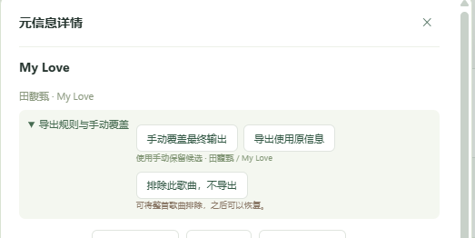

# 界面截图素材

保存经过核对的真实客户端画面，供项目 README 和使用说明复用。截图需要确认目标窗口、界面版本与操作状态，避免包含其他应用或聊天内容。

## 元信息管理：改版前

来源：用户提供的截图，展示原有“详情 → 导出规则 → 手动覆盖”入口。

## 元信息管理：改版后

最新界面已提供字段候选快捷选择、去重后的整组填入、直接手输及统一保存。完整画面待双显示器捕获核对正常后补充；不使用遮挡、跨屏错位或混入其他应用的画面作为示例。

建议保留两种状态：最终元信息编辑区，以及展开整组候选下拉框的状态。截图时只填入草稿，不为演示而保存真实歌曲的修改。
